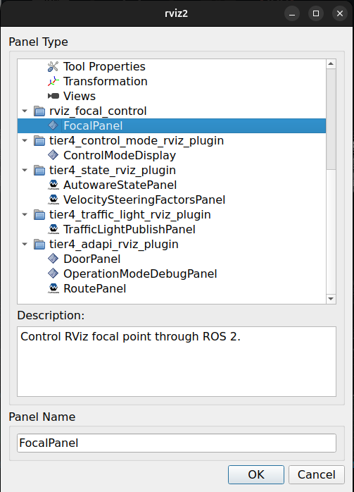
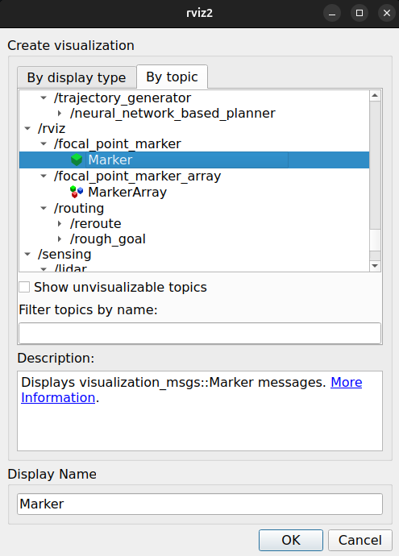

# RViz Focal Point Control

Move the RViz camera's focal point with your keyboard, visualize it with a target reticle, and publish that position as a mission-planning goal.

This ROS 2 package provides an RViz panel (`FocalPanel`) and a terminal keyboard node (`keyboard_focal_control`). Use the arrow keys to position the target, **Enter** to send a goal, and **R** to return the camera center to your vehicle.


https://github.com/user-attachments/assets/d253e1f0-7ce3-4604-9cc1-2528afdfe846


## Build

The commands below use **ROS 2 Jazzy**, a Bash shell, and a colcon workspace at `~/ros2_ws`. You need ROS 2 with RViz, colcon, and rosdep installed. The keyboard node requires an interactive Unix terminal.

Place this repository at `~/ros2_ws/src/rviz_focal_control`, then install dependencies and build:

```bash
source /opt/ros/jazzy/setup.bash
cd ~/ros2_ws
rosdep install --from-paths src --ignore-src -r -y
colcon build --packages-select rviz_focal_control
source install/setup.bash
```

## Set up RViz

Start RViz from a terminal with the workspace sourced:

```bash
source /opt/ros/jazzy/setup.bash
source ~/ros2_ws/install/setup.bash
rviz2
```

If you use RViz through an existing robotics application, launch it with the same workspace overlay sourced.

### 1. Add the control panel

Open **Panels → Add New Panel**, expand **rviz_focal_control**, select **FocalPanel**, and click **OK**.



### 2. Choose a supported view

In the **Views** panel, set **Type** to **Orbit** or **XYOrbit**. The active view must expose a **Focal Point** property.

Set RViz's **Fixed Frame** to a frame available in your application. To use the vehicle reset feature, TF must connect `base_link` to that fixed frame.

### 3. Add the target marker

In **Displays**, click **Add**, switch to **By topic**, and select **Marker** under `/rviz/focal_point_marker`. Click **OK**.



Use the **Marker** display for `/rviz/focal_point_marker`, not the separate `MarkerArray` entry shown in the screenshot. Ensure the display and its `focal_crosshair` namespace are enabled.

The target appears as a camera-facing cyan-and-gold reticle centered on the focal point. FocalPanel shows its fixed frame, coordinates, and marker subscriber count. Save your RViz configuration to keep this setup.

## Run the keyboard controller

In a separate interactive terminal:

```bash
source /opt/ros/jazzy/setup.bash
source ~/ros2_ws/install/setup.bash
ros2 run rviz_focal_control keyboard_focal_control
```

**Keep keyboard focus in this terminal** while controlling the focal point.

| Key | Action |
| --- | --- |
| ↑ | Move by `+step` along X |
| ↓ | Move by `−step` along X |
| ← | Move by `+step` along Y |
| → | Move by `−step` along Y |
| Enter | Stop repeating and publish the latest received focal point as a goal |
| R / r | Stop repeating and reset the focal point to `base_link` |
| Q / q or Ctrl+C | Exit and restore terminal settings |

The default step is **1.0 m per message**. Arrow keys leave Z unchanged. Movement follows the view's focal-point axes, so its direction on screen depends on camera orientation.

A single tap moves one step. Holding an arrow starts continuous publishing after consecutive terminal repeat events, at up to **50 Hz** by default. The terminal's initial repeat delay still applies. Terminals do not report key release, so publishing stops when no repeat has arrived for `key_timeout` seconds; some movement after release is possible.

For finer control, use a 0.1 m step:

```bash
ros2 run rviz_focal_control keyboard_focal_control --ros-args -p step:=0.1
```

At 50 Hz, a 0.1 m step moves the focal point at approximately 5 m/s during continuous repeat; the default 1.0 m step gives approximately 50 m/s.

### Send a goal

Press **Enter** to publish a `geometry_msgs/msg/PoseStamped` on `/planning/mission_planning/goal`. The goal uses:

- The latest received marker's X, Y, and Z coordinates.
- RViz's fixed frame, including when the view tracks a moving target frame.
- An identity orientation: zero yaw, facing +X in the goal frame.

No goal is sent until the keyboard node receives a focal marker. The reticle faces the camera for visibility, but its orientation does not determine the goal heading. A planner subscribed to the goal topic is required to act on the published pose.

### Return to the vehicle

Press **R** to set the view's **Target Frame** to `base_link` and its **Focal Point** to `(0, 0, 0)`. The camera centers on the vehicle and follows it while preserving zoom and orientation.

Reset requires an Orbit or XYOrbit view and an available TF transform for `base_link`. If the transform is unavailable, the panel logs a warning and leaves the focal point unchanged. Reset does not send a goal; press Enter separately when ready.

## Configuration

The keyboard node accepts these ROS 2 parameters at startup. All values must be finite and greater than zero.

| Parameter | Default | Meaning |
| --- | --- | --- |
| `step` | `1.0` | Distance in meters per offset message |
| `publish_rate` | `50.0` | Continuous-repeat publishing rate in Hz |
| `key_timeout` | `0.1` | Seconds without a terminal repeat before movement stops |

```bash
ros2 run rviz_focal_control keyboard_focal_control --ros-args \
  -p step:=0.1 \
  -p publish_rate:=50.0 \
  -p key_timeout:=0.1
```

Terminal repeat events must arrive faster than `key_timeout` for continuous movement.

To send goals to a different topic:

```bash
ros2 run rviz_focal_control keyboard_focal_control --ros-args \
  -r /planning/mission_planning/goal:=/goal_pose
```

## ROS 2 interface

| Topic | Message type | Direction |
| --- | --- | --- |
| `/rviz/focal_point_offset` | `geometry_msgs/msg/Vector3` | Keyboard → panel |
| `/rviz/focal_point_reset` | `std_msgs/msg/String` | Keyboard → panel; string contains the target frame |
| `/rviz/focal_point_marker` | `visualization_msgs/msg/Marker` | Panel → RViz display and keyboard |
| `/planning/mission_planning/goal` | `geometry_msgs/msg/PoseStamped` | Keyboard → external planner |

The panel publishes the marker with transient-local durability and a history depth of 1. Its namespace is `focal_crosshair`, with marker ID `0`.

Other ROS 2 nodes can publish offsets, including Z movement, or request a reset to a different TF frame. For example:

```bash
ros2 topic pub --once /rviz/focal_point_reset std_msgs/msg/String "{data: 'base_link'}"
```

If you remap an offset, reset, or marker topic, apply matching remappings to the communicating nodes and update the Marker display topic as needed.

## Troubleshooting

| Symptom | What to check |
| --- | --- |
| FocalPanel is missing from the panel list | Build the package, source `install/setup.bash`, and restart RViz from that terminal. |
| The panel reports “No Focal Point in this view” | Select **Orbit** or **XYOrbit** in **Views → Type**. |
| The reticle is missing | Check the panel status, RViz's fixed frame, the Marker display topic, and the `focal_crosshair` namespace. |
| Arrow keys do nothing | Keep focus in the keyboard terminal, load FocalPanel, and select a supported view. |
| Holding an arrow produces intermittent steps | Check terminal key repeat; repeat events must arrive within `key_timeout`. |
| Enter reports “No focal point received from RViz yet” | Load FocalPanel and check that it is publishing `/rviz/focal_point_marker`. |
| R does not return to the vehicle | Check TF between `base_link` and the fixed frame, and use Orbit or XYOrbit. |
| Changes are not visible after rebuilding | Restart RViz with the rebuilt workspace sourced; restart the keyboard node if its code changed. |
